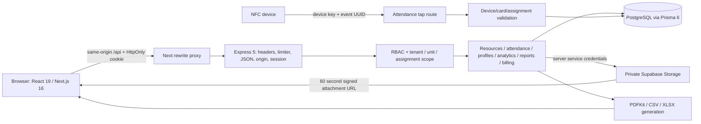

# Operations OS security and production readiness assessment

Assessment date: 17 October 2026 (Asia/Kolkata). Scope: repository implementation and local regression tests. Changes are provided as reviewable Git changes. No cloud plans, credentials, or production business records were changed.

## A. Executive assessment

**Production readiness: conditional; not certified for production.** The application has substantive security controls: database-backed revocable sessions, bcrypt cost 12, exact-origin mutation checks, server-side permission and tenant filters, strict write schemas, composite tenant foreign keys, SQL constraints, and serializable operational transactions. This review identified and fixed a profile permission bypass, silent truncation of newly created bcrypt passwords, an employee-account linking race, and unsafe handling of JSON parser errors. Missing-link scope handling was hardened.

The expanded API/frontend recovery suite passed 80 tests; both workspaces passed type checking. Six browser workflows were observed passing before that run was interrupted; the complete browser suite, load test, and recovery drill are not claimed as passed. The production dependency scan returned zero known advisories. Private cloud settings and unfinished checks require further verification. The inventories document accessible implementation and remaining work, not exhaustive certification.

Artifacts:

- [API matrix](api-matrix.csv): 160 rows, expanding generic resource routes over the catalog. Includes authentication, authorization, input controls, and review priority. Readonly resources still have matched generic write routes but reject writes; attendance uses its dedicated register.
- [Source inventory](source-inventory.csv): reproducible file paths, line counts, hashes, and review coverage descriptions. Inventory does not mean every line was manually reviewed.
- [Resolved core versions](dependency-versions.json), extracted from the lockfile rather than package ranges.
- [Production dependency SBOM](sbom.cdx.json), CycloneDX generated by npm.
- [Public deployment checks](public-validation.json): read-only live Render headers, probes and anonymous access result. See follow-up observations below.
- [Local validation evidence](local-validation.json): latest isolated run, including failures; do not infer success from an artifact's existence.
- `node scripts/audit-inventory.mjs` regenerates inventories without credentials or production access.

## B. Architecture and trust boundaries

Browser restrictions are presentation only. Express authenticates every protected `/api` request; services authorize reads and mutations. Public probes, device taps, and login precede session middleware. Browser mutations require the configured exact Origin; NFC ingestion uses device credentials instead. Login issues a random 48-byte opaque token; its HMAC is persisted with eight-hour expiry. Authentication reloads the user's active state, role grants, linked employee/client, and assigned sites. Logout deletes its session; account status changes revoke sessions. No JWT, OAuth, refresh-token, webhook, registration, MFA, or recovery implementation was found.

Organization owns business units, roles, users, operational and financial records. Employees link to users and manager/supervisor hierarchies; client → contract/site → assignments → employee/shift defines operational scope. Attendance and NFC events record work. Waste → disposals and machines → batches/events/maintenance define the two operating divisions. Invoice → payments and challans → saved PDF snapshots define billing. PersonProfile uses a polymorphic subject key; assets/payments reference that profile. Composite tenant foreign keys and SQL constraints supplement application checks; polymorphic subject ownership remains application-enforced.

Production configuration includes Docker multi-stage builds, non-root runtime images, a migration job, internal API networking, localhost web binding, readiness checking, and separate Render web/API services with external Neon PostgreSQL. PostgreSQL 17 is configured in Compose/CI; the optional embedded development package targets PostgreSQL 18. Execution host Node was 24.11.0; deployment targets Node 22, so production-runtime parity remains to be checked.

## C. Frontend review

| Route / components | Observed controls and flow | Remaining validation |
|---|---|---|
| `/login` | Controlled form → login API; generic credential error; cookie managed by browser | Browser login/logout, keyboard, password-manager and failure-state checks |
| Workspace layout / shell | Fetches identity and permission-filtered catalog; centralized API helper redirects expired sessions | Real session expiry, back navigation, multiple tabs |
| `/` / WorkspaceHome | Supervisor opens attendance; customer opens scoped site/team view; other roles open dashboard | Every seeded role in browser |
| `/[module]` / ModulePage / Records | Permission-based module selection; catalog-driven forms and server pagination; server rejects unauthorized direct requests | Every catalog field/form, narrow screens, failed relation lookup and stale saves |
| `/attendance` | Dedicated register with server versions and locked marks; future marking rejected server-side | Keyboard marking and simultaneous browser edits |
| `/viagreen`, `/anthrasite`, Dashboard | Scoped analytics; date/unit inputs | Representative query volume, chart accessibility and timezone edges |
| `/reports` | Date checks, authenticated blob fetch, object URL cleanup; server applies read scope and formula escaping | Large CSV/XLSX/PDF downloads and screen-reader feedback |
| `/settings` | User/status/permissions/device/card actions; APIs enforce permissions | Permission changes across open tabs and key-display lifecycle |
| `/profiles/[type]/[id]`, profile dialogs | Scoped owner resolution; field/asset visibility determined by API; capability flags now honor write revocation | Full role matrix and long/unusual input rendering |
| Org chart / zoom viewport | Minimal person fields, keyboard zoom, bounded zoom, wheel listener cleanup | Large hierarchy rendering and assistive technology traversal |
| Saved PDFs | Authenticated saved snapshots and downloads | Browser pagination, print layout and logo edge cases |
| Loading/error/not-found and UI primitives | Reusable feedback; Radix dialog titles/descriptions and labeled close button | Automated accessibility scan and manual focus/contrast checks |

Searches found no credential storage in localStorage/sessionStorage. localStorage usage is theme preference. The inline layout script is constant theme initialization, not interpolated user content. React renders record text; no user-controlled HTML sink was identified in the targeted search. This is not a full XSS proof. Web headers set nosniff, frame denial and referrer policy; a browser document CSP is absent. Introducing a strict script CSP needs Next hydration/theme testing and is deferred.

## D. Backend and workflow review

| Module | Controls traced | Limits / next action |
|---|---|---|
| app/config/server | Helmet, configured CORS, 256 KB JSON cap, request IDs, redacted request headers/body, global and login limits, HTTPS production origin, graceful shutdown | Verify trusted ingress and shared edge limiting; memory limits are per process |
| auth | Cost-12 bcrypt, dummy comparison, HMAC sessions, fresh role grants, active account checks, tenant admin validation | MFA/recovery absent; expired-session retention not scheduled |
| resources | Catalog allowlists, strict schemas, scoped list/detail, linked-record validation, server-generated metadata, transaction audit, post-write scope check | Dynamic repository uses `any`; expand negative tests for all catalog resources |
| resources workflows | Assignment overlap, hierarchy cycles, ticket transitions, disposal balance, batch state, invoice/payment balance protected transactionally | Concurrency tests need actual competing requests and production-scale fixtures |
| attendance NFC | Active device/card/employee, active site assignment, timestamp tolerance, event-key deduplication, short debounce, serializable writes | Shared keys need operational rotation/revocation process; device hardware not exercised |
| manual attendance | Role + permission + team validation, strict roster, duplicate rejection, version checks, reviewed-mark lock, serializable writes | Up to 200 entries and per-entry database work; profile representative roster latency |
| profiles | Scoped owner, minimized output, distinct public/photo/ID/private/pay visibility, audited sensitive file reads | See identity-disclosure policy question below; polymorphic subjects lack direct subject FK |
| billing | Scoped immutable source snapshots, Decimal tax/payment math, content fingerprint deduplication, validated bounded logos | Rendering and storage consume API process resources; no measured concurrency budget |
| documents | Scoped parent, unit match, MIME/signature allowlist, random object paths, compensating removal on DB failure, 60-second download links | No malware scanning; Office validation checks ZIP prefix only; actual bucket policy not tested |
| reports | reports + resource read grants, same tenant scope, 10,000-row cap, formula neutralization | In-memory export and database count cost; no measured latency/memory |
| notifications | Per-rule read permission and scope, 500-row rule cap, daily deduplication | Up to 3,500 sequential upserts/request; triggered by users rather than scheduled worker |
| analytics | Per-resource read grants, scoped filters, <=366-day range | Unbounded scoped queries and repeated in-memory joins; see performance assessment |

Major roles found: Super Admin, Business Manager, Operations Manager, Site Supervisor, Worker, Finance/Admin, Customer, Accountant. Seeded development accounts are optional environment-provided identities; production provisioning creates fewer roles with empty non-admin grants and explicitly requires configuration. This difference is intentional in existing provisioning, but the complete production role setup needs operational validation.

## E. API assessment

The matrix is extracted from actual Express route declarations, with source line numbers and catalog expansion. All session routes inherit the global limiter and no-store response; all browser write routes inherit Origin verification. Specific route authorization remains in the called service. Review priorities describe consequences of bugs, not discovered exploitable vulnerabilities. Query pagination is capped at 100 for generic lists; some dedicated lists are capped separately; dashboard and team/chart collections are not globally paginated.

Negative tests exercised unauthenticated access, cross-site/cross-tenant reads, permissions, CSRF, foreign-key integrity, invalid content, payment overflow, attendance versions/locks, and dedicated profile write revocation. Full endpoint/role permutation testing is outstanding. No external production DAST, fuzzing, or credential attack was performed.

## F. Database, infrastructure and supply chain

Initial and integrity migrations define tenant relationships, positive quantity/payment constraints, date/state constraints, operational date indexes, session expiry index, and RLS. RLS has no browser policies; the trusted API database role bypasses/owns access and must remain server-only. Later profile tables do not gain RLS from the earlier migration's one-time loop; verify database grants and apply a reviewed RLS migration if those tables can be reached through a browser-facing data service. This is an exposure-dependent concern, not a demonstrated remote exploit.

The seed refuses `NODE_ENV=production`, validates distinct emails and bounded passwords, uses deterministic development IDs and skip-duplicate inserts. This guard does not identify whether a development-configured process points at a production database: operations must isolate seed credentials/access. No seed or migration was executed for this assessment.

`.dockerignore` excludes env files, local data and Git history; `.gitignore` excludes env/local output. CI runs install, Prisma generate/deploy, typecheck, tests, build and production dependency audit. The CI database password is an isolated test fixture, not a production secret finding. No verified real secret value is included in these artifacts. This was a targeted source search, not a full repository-history or provider secret scan. Cloud IAM, bucket permissions, TLS settings, encryption, backup retention/restore evidence and runtime grants were not available for verification.

## G. Finding register

CVSS scores are omitted: environmental/exploitation evidence is insufficient for defensible v4 scores. Severity below is qualitative. Line references refer to the remediated tree.

### SEC-01 — Manager profile mutations ignore revoked write grants

- Severity **High**, priority P1; CWE-863; OWASP API5 Broken Function Level Authorization.
- Location: `apps/api/src/modules/profiles/service.ts:73` (access), with enforcement in updateProfile/uploadAsset/addPayment.
- Confirmed root cause: mutation capability depended on manager role name and owner visibility rather than the resource write grant. An authenticated manager with read access could retain profile edit/upload/staff-payment capability after an administrator revoked employee write permission.
- Impact: unauthorized profile changes, file uploads, and staff payment recording within the existing visible scope; not a demonstrated cross-tenant bypass.
- Fix: require corresponding resource write permission for management mutations; users require users:manage. Preserve existing own-customer editing policy. Capability responses use the same decision.
- Verification: regression temporarily soft-deletes manager employees:write grant while retaining its existing session; GET remains allowed, canEdit/canPay false, PATCH/upload/payment return 403; grant restored in finally. Confirmed by local PostgreSQL test.
- Compatibility: managers configured with read-only grants lose mutation capability as intended. Existing normal seeded manager grants remain sufficient. Rollback: revert access predicate; that reopens the bypass.

### SEC-02 — New bcrypt credentials silently truncate beyond 72 bytes

- Severity **Medium**, P1; CWE-187 (partial comparison), OWASP A07 Identification and Authentication Failures.
- Locations: `apps/api/src/modules/auth/password.ts:1`, `apps/api/src/modules/auth/admin.ts:10`, `packages/database/prisma/provision.ts` bootstrap password field.
- Confirmed by implementation: admin/provision accepted up to 128 characters while bcrypt only processes 72 UTF-8 bytes. Multibyte passwords hit this boundary before 72 characters. Preconditions: a newly provisioned credential exceeds the byte boundary. Impact: suffixes do not contribute to authentication strength.
- Fix: shared schema rejects new credentials over 72 UTF-8 bytes, preserving minimum 14 characters and cost 12. Existing login semantics remain compatible; existing affected credentials require deliberate account-owner remediation, not automatic rotation.
- Verification: ASCII 72/73-byte and Devanagari 72/75-byte boundary tests pass. Existing seed already enforced the byte limit.
- Rollback: revert schema imports; no data migration. Guidance: [OWASP password storage](https://cheatsheetseries.owasp.org/cheatsheets/Password_Storage_Cheat_Sheet.html).

### SEC-03 — Concurrent account creation can replace an employee link

- Severity **Medium**, P1; CWE-367 time-of-check/time-of-use.
- Location: `apps/api/src/modules/auth/admin.ts:93`.
- Static confirmed race: validation checked userId null outside transaction, then updated by employee ID unconditionally. Two authorized administrator requests could both validate and the later update replace the first link. Impact: incorrect account-to-employee authorization mapping.
- Fix: transactional conditional update requires tenant, unit, undeleted employee and userId null; exactly one claim must succeed, otherwise 409 rolls back new user creation.
- Verification: mocked losing-claim transaction rejects and does not write audit event. This proves the code branch, not a real competing PostgreSQL schedule or rollback integration test. Add a two-request integration test before high-concurrency rollout.
- Rollback: revert updateMany claim; no migration required.

### SEC-04 — JSON parser errors become internal errors and may retain body in logs

- Severity **Medium**, P1; CWE-532 sensitive information in logs.
- Location: `apps/api/src/app.ts:475`.
- Static confirmed flow: malformed/oversized parser errors reached generic error logger; parse error objects can carry submitted body. Request body redaction did not redact an error object's separate body field. HTTP response also incorrectly returned 500.
- Fix: recognize parser error types before generic logging; return bounded generic 400/413; establish request IDs and limiter before JSON parsing. No supplied body is returned or logged through this path.
- Verification: malformed credential-shaped JSON and oversized JSON return correct codes, request ID and no payload reflection. Log-sink contents were not independently captured.
- Rollback: revert parser-specific branch and middleware order; no migration.

### HARD-01 — Missing worker/unit links produce null identifier filters

- Severity **Low**, P2; robustness hardening, not a confirmed data disclosure.
- Location: `apps/api/src/modules/resources/scope.ts:4`.
- Null UUID filters could yield ORM errors, while nullable assigneeId filters could match unassigned tasks if other scope conditions allowed. Normal missing employees have no derived sites; no exploitable read was demonstrated.
- Fix: consistent impossible UUID filters for missing worker/unit IDs. Six scope regression cases pass. Keep employee IDs mandatory for assigned-role provisioning.

### OPEN-01 — Dashboard and notification resource consumption

- Severity **Medium**, P2; static resource-exhaustion concern, CWE-400 / OWASP API4.
- Locations: `apps/api/src/modules/analytics/service.ts:25`, `apps/api/src/modules/notifications/service.ts` per-record upserts.
- Authorized users can request broad data; dashboard reads entire scoped datasets, while notifications perform many sequential writes. There is no measured denial of service. Implement SQL rollups/selected columns, workload budgets and scheduled/batched notifications after profiling; preserve complete financial totals rather than silently truncating rows. Test with representative volumes and concurrent users.

### OPEN-02 — Staff identity exposure is an explicit business policy

- Severity **Informational**, policy confirmation required.
- Location: `apps/api/src/modules/profiles/service.ts:79` identity decision and `:144` government ID output.
- Assigned customers can see staff government ID numbers/proofs; existing tests explicitly require this. No change made because the review must preserve intended business behavior. Confirm purpose, consent, retention, and whether masking or separate identity permission is appropriate. This is not reported as an unauthorized-access exploit.

### OPEN-03 — Upload authenticity and malware controls

- Severity **Medium**, P2, static hardening gap.
- Location: `apps/api/src/modules/documents/service.ts` signature allowlist.
- DOCX/XLSX checks accept a ZIP prefix without checking Office package structure; permitted files are not malware scanned. Uploads require permission and scoped ownership; download uses attachment URLs. Add bounded archive metadata validation, quarantine/scanning and private storage policy verification. Test polyglots, unrelated ZIPs, decompression budgets and scanner failure. No stored malware execution was demonstrated.

### OPEN-04 — Missing browser CSP / distributed abuse and identity controls

- Severity **Low to Medium**, deployment-dependent hardening.
- Locations: `apps/web/next.config.ts`, `apps/api/src/app.ts` limiter setup, auth module.
- Browser HTML lacks CSP; in-memory IP limits behind the Next proxy can aggregate clients and reset per process; MFA/recovery are absent. Existing deployment docs require trusted edge rate limiting. Do not enable trust proxy globally without a verified proxy chain: [Express proxy guidance](https://expressjs.com/en/guide/behind-proxies/). Stage CSP reporting/hydration tests, shared edge limits and approved MFA/recovery design.

## H. Performance assessment

No load test, EXPLAIN ANALYZE, memory profile or latency benchmark was executed. Observations are algorithmic/static:

- Analytics loads O(N) scoped rows; per-site filtering costs O(S × (W + A + T + V)), per-client joins scan sites/invoices, machine history filtering costs O(M × E) plus sorting. Index by site/client/machine in memory or aggregate in SQL; push date filters and selected columns into queries. Keep monetary aggregation in Decimal/SQL to avoid accumulated Number rounding.
- Scheduled attendance expands days × assignments (bounded at 366 days but not assignment count). Prefer SQL date series/rollups or cached daily totals after measuring size.
- Notification refresh is up to seven queries × 500 records and one upsert each. Use batched writes with dedupe uniqueness and a scheduled worker, plus a dedicated workload limit.
- Manual attendance repeatedly searches roster/records and writes rows/audits individually within a 30-second transaction. Maps improve CPU lookup; batch operations must preserve version/override checks and all-or-nothing behavior.
- Report cap avoids unlimited export rows but not count cost or individual large fields. Streaming/paged extraction and separate workers can reduce memory and CPU contention.
- Binary profile assets and immutable PDFs live in PostgreSQL, increasing backup/retention size. Define quotas/retention and evaluate private object storage while preserving authorization and snapshot integrity.
- Next.js/Recharts client rendering and generic records are candidates for bundle profiling; no measured frontend rerender or bundle regression is claimed.

## I. Prioritized roadmap

1. Review the implemented patch and permission compatibility; validate on the deployment Node version and staging database. No schema migration or secret rotation is required for this patch.
2. Before go-live: verify external storage privacy, API-only database grants/RLS on newer tables, TLS, ingress forwarding, shared rate limiting, backup restore, log retention and alert delivery. Confirm staff identity disclosure policy.
3. Add real concurrent employee-claim, invoice/payment, assignment and NFC replay tests; cover each catalog relation with cross-tenant/cross-unit attempts. Run existing browser tests with controlled synthetic credentials and accessibility checks.
4. Profile representative dashboard/report/notification workloads; implement SQL aggregation, batching, workload quotas and scheduled notifications based on evidence.
5. Stage CSP, malware quarantine/scanning and approved MFA/recovery flows. Add a vetted secret/history scanner, SAST and container/IaC scanning to CI; pin/review action SHAs and release provenance according to organizational policy.
6. Establish retention, deletion, restore drills, release rollback and operational ownership. Review migration changes against a staging snapshot before deployment.

## J. Production readiness checklist

| Control | Status | Evidence / limit |
|---|---|---|
| Server permission and tenant denial tests | Pass | Local suite; not every endpoint/role permutation |
| Dedicated profile write revocation | Pass | Existing-session negative regression |
| bcrypt new credential byte bounds | Pass | Shared schema and boundary tests |
| Session expiry/revocation implementation | Pass | DB expiry/status checks; browser lifecycle not tested |
| Origin/CSRF rejection | Pass | API regression; ingress forwarding not tested |
| Malformed/oversized JSON behavior | Pass | 400/413 regression |
| Account link concurrency claim | Pass | Real concurrent PostgreSQL claim and losing-user rollback regression |
| Production dependency audit | Pass | npm audit --omit=dev: 0 advisories at assessment time |
| TypeScript checks | Pass | Both API and web |
| Production build | Pass | API TypeScript and Next optimized build; deployment Node 22 parity outstanding |
| Browser workflow/accessibility checks | Not Tested | Six workflows passed; complete suite interrupted; full accessibility review outstanding |
| Browser document CSP | Fail | Not configured |
| Malware/quarantine validation | Fail | No scanner; limited signatures |
| MFA / self-service recovery | Fail | Not implemented; business requirements need decision |
| Distributed edge abuse protection | Not Tested | Deployment prerequisite; not proven here |
| Full secret/history/SAST/container/IaC scans | Not Tested | Targeted source searches only |
| Private bucket and runtime grants | Not Tested | No live cloud access used |
| TLS, encryption at rest, IAM | Not Tested | Provider configuration unavailable |
| Backups, PITR, restore and rollback drill | Not Tested | No operational evidence |
| Capacity / load / stress testing | Not Tested | Static analysis only |
| OAuth/JWT/webhook signature checks | Not Applicable | These integrations were not found |

## K. Patch validation and rollback

Implemented files: API app middleware/errors, auth password schema and admin user linking, profile capabilities, resource scopes, production bootstrap password schema, security/profile regression tests, and inventory generator. Revert these source/test changes together to roll back; this restores the prior weaknesses. No migration, credential rotation, production deploy, or business-data cleanup is part of the patch.

Executed: `npm.cmd run typecheck` (pass), `npm.cmd test` (5 files / 64 tests pass), `npm.cmd run build` (API and optimized Next build pass), `npm.cmd audit --omit=dev --json` (zero advisories), `npm.cmd sbom --omit=dev --sbom-format=cyclonedx` (generated), and inventory generation. Initial sandbox test launch failed with EPERM; the suite subsequently passed with process execution approval. No test pass is inferred from source presence.

Remaining coverage explicitly includes complete frontend line-by-line review, browser/e2e/accessibility execution, actual cloud/production controls, full history scanning, dependency source review, Docker image execution, database restore tests, real concurrent race reproduction and benchmarks. Local `.local` historical outputs/backups and env secret values were excluded from audit evidence; their presence is not proof of current deployed behavior.

## Follow-up deployment observations — 17 October 2026

Read-only HTTPS checks were authorized against `https://operations-os-web.onrender.com/`. At 07:31 UTC (13:01 IST), root/login returned 200 while the three API probe/identity routes returned 502. At 07:42 UTC (13:12 IST), root/login, `/api/health` and `/api/ready` returned 200, and `/api/auth/me` correctly returned 401 without a session. The latest snapshot is retained in `public-validation.json`. The initial failure was transient; cold starts, proxy/upstream behavior and provider availability are possible explanations, not established causes. No deployment or configuration change was made to cause the recovery.

Live HTML responses included frame denial, nosniff and referrer policy, but lacked CSP and HSTS. API responses included Helmet CSP/HSTS, no-store, request IDs and the configured frontend CORS origin. API CSP does not protect the HTML document; retain the browser CSP/HSTS follow-up. Readiness proves that the configured database answered a query, not that database grants, tenant isolation, backups or Neon settings are correct.

The user also supplied a private Neon project/branch console URL. The browser tool reported no connected browsers and could not create an in-app browser; the unauthenticated web tool could not access that console. Project IAM, retention/PITR, encryption settings, role grants, private storage and provider logs therefore remain unverified due to unavailable authenticated access, rather than being inferred from the console URL. No production credentials were requested or exposed. To complete this portion, use a connected signed-in provider session and collect read-only settings evidence; perform any provider restore in an explicitly isolated target.

The workstation had about 250–350 MB free memory during follow-up runs. Two harness attempts aborted inside the Prisma CLI before tests; a later run applies the checked-in SQL directly to an empty disposable cluster with a smaller memory budget. These attempts are failures, not evidence of a production application vulnerability. The new account-link integration test initially lacked a real audit actor, which the database foreign key correctly rejected; the fixture was corrected before rerunning. Final local results are recorded separately below.

### REL-01 — Recurring upstream failures leave the workspace on an error screen

Severity Medium, priority P1 (availability). At 16:48 UTC (22:18 IST), the public proxy again returned 502 while HTML pages returned 200. A subsequent direct API health request returned 200 after about 23 seconds, then readiness returned 200. Render's documented free-instance startup behavior is a likely contributor; provider logs are needed to confirm the full cause.

The original `apps/web/src/lib/api.ts` immediately surfaced a generic unavailable error and could accept HTTP 200 HTML startup pages as API data. The fix retries only GET reads after network/gateway failures or invalid success payloads, with backoff, per-attempt timeout, at most 11 attempts and a 90-second total budget. Cancellation clears recovery feedback; ordinary permission, validation and rate-limit errors remain immediate. Mutations are never automatically replayed. Login waits for a safe health check before sending credentials once. The loading state explains connection recovery.

The isolated suite passed seven files / 80 tests, including 15 frontend recovery cases and the real employee-account race. The subsequent browser run passed billing PDFs, chart expansion, manager/customer profiles, login warm-up/logout and automatic gateway/HTML recovery. It was interrupted before the other scenarios and before load/recovery phases. `local-validation.json` records this partial result. The patch improves recovery but does not change provider billing or make free instances always-on. Previous successful public probes are not evidence of permanent resolution.
